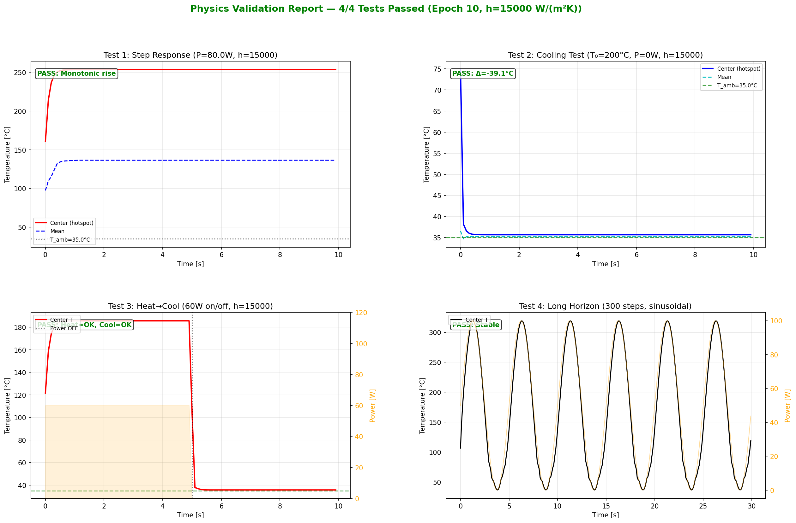
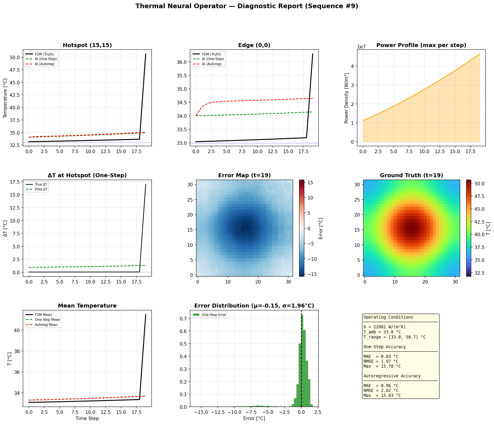
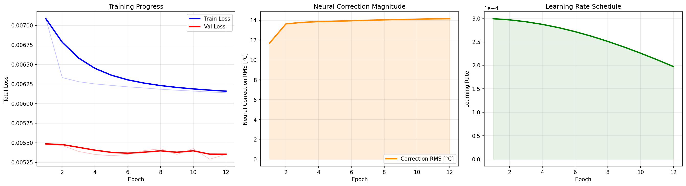

# Transient Thermal Neural Operator for SiC MOSFET T_j Estimation

Real-time junction temperature estimation using a **physics-augmented neural operator**, designed for deployment on STM32 microcontrollers.



## Problem

Accurate junction temperature (T_j) estimation in SiC MOSFETs is critical for reliable power electronics design, but traditional FEM/FDM solvers are too slow for real-time control loops. This project replaces the solver with a lightweight neural operator that runs in <10ms per frame.

## Approach: Hybrid Physics-ML

Instead of a purely data-driven model, we combine an **unconditionally stable physics baseline** with a **learned spatial correction**:

```
ΔT = ΔT_physics + ΔT_correction

ΔT_physics = (α·P − β·h·(T − T_amb)) / (1 + β·h)       ← Implicit Euler (0D)
ΔT_correction = scale · tanh(UNet(P_t, P_{t-1}, T_{t-1}, T_amb, h))  ← Learned
```

**Why this works:**
- The physics residual handles bulk thermodynamics (heating, Newton's cooling) — always stable, even without training
- The U-Net only needs to learn the *spatial correction* (diffusion, hotspot shape, edge effects) — a much easier task
- `tanh` clamping architecturally limits the correction to ±30°C per step — prevents autoregressive blowup

## Results

### Benchmark (50 random test sequences, 95% CI)

| Metric | One-Step | Autoregressive |
|--------|----------|----------------|
| **MAE** | 9.19 °C (CI: 6.67–11.71) | **8.56 °C** (CI: 6.37–10.76) |
| RMSE | 13.15 °C | 12.26 °C |
| Max | 57.66 °C | 56.10 °C |

Autoregressive MAE is *lower* than one-step — the model does not accumulate errors over time.

### Physics Validation (4/4 PASS)

| Test | What it checks | Result |
|------|---------------|--------|
| Step Response | Constant power → monotonic rise | ✓ |
| Cooling Law | P=0, T>T_amb → exponential decay | ✓ |
| Heat+Cool | Power on/off → correct direction | ✓ |
| Long Horizon | 300-step sinusoidal → bounded | ✓ |

### Diagnostic Plot



## Architecture

| Component | Details |
|-----------|---------|
| **Parameters** | 48,106 (< 147k STM32 budget) |
| **Inputs** | P_t, P_{t-1}, T_{t-1}, T_amb, h — 5 channels + CoordConv |
| **Output** | ΔT map (32×32) |
| **Encoder** | 3 stages [16, 32, 48 ch] — Depthwise Separable Conv |
| **Bottleneck** | 64 channels |
| **Decoder** | 3 stages [48, 32, 16 ch] — Attention-Gated skip connections |
| **Physics** | Implicit Euler residual (zero extra parameters) |

## Data Generation

The training data comes from a **2D transient FDM solver** coupled with a **SiC electro-thermal loss model**:

- **Conduction loss:** P_cond = I²(t) × R_ds_eff
- **Switching loss:** P_sw = f_sw × V_dc × |I(t)| × E_sw
- **Drive cycles:** Random acceleration / braking / idle segments (25% idle for cooling data)
- **FDM solver:** `scipy.integrate.solve_ivp` (BDF method) on 32×32 grid

| Parameter | Range |
|-----------|-------|
| h (convection) | 5,000 – 30,000 W/(m²K) |
| I_peak | 20 – 75 A |
| V_dc | 400 – 800 V |
| T_amb | 25 – 60 °C |
| Grid | 32×32, dt = 0.1s |
| Dataset | 1,000 sequences × 100 frames |

## Training

- **Loss:** Log-Cosh (robust to outliers) + Physics Drill (synthetic cooling enforcement)
- **Regime:** Fully autoregressive from epoch 1 (no teacher forcing)
- **Optimizer:** AdamW, cosine LR schedule (3e-4 → 3e-6)
- **Gradient clipping:** 0.5
- **Hardware:** Apple M2 (MPS backend), ~14 min/epoch



## Quick Start

```bash
# 1. Setup
python3 -m venv venv && source venv/bin/activate
pip install -r requirements.txt

# 2. Generate data (~30 min on M2)
python data_gen.py

# 3. Train (~7h on M2)
python train.py --fresh

# 4. Validate physics
python validate_physics.py

# 5. Diagnostic visualization
python test_vis.py --checkpoint checkpoints/best_model.pth

# 6. Benchmark (50 random test sequences)
python benchmark_eval.py --n 50

# 7. Export for STM32
python export.py
```

## Project Structure

```
├── data_gen.py            # FDM solver + SiC electro-thermal loss model
├── model.py               # Physics-augmented U-Net (48k params)
├── train.py               # Autoregressive training + physics drill
├── validate_physics.py    # 4 physics stress tests
├── test_vis.py            # 9-panel diagnostic visualization
├── benchmark_eval.py      # Statistical benchmark (MAE, RMSE, 95% CI)
├── export.py              # ONNX export + INT8 quantization
├── requirements.txt
├── .gitignore
├── visualizations/         # Generated plots
│   ├── learning_curve.png
│   ├── physics_validation.png
│   ├── diagnostic_plot.png
│   └── benchmark_50seq.png
└── docs/
    └── BENCHMARK_SUMMARY.md
```

## Key Design Decisions

1. **Implicit Euler, not Explicit** — denominator `(1 + β·h)` > 1 guarantees |gain| < 1 for any `h`, making the physics baseline unconditionally stable.

2. **Zero-initialized correction** — at epoch 0 the model is a pure physics solver. The neural network gradually learns to improve upon it.

3. **No teacher forcing** — training and validation are both fully autoregressive. This eliminates the train/val mismatch that causes oscillating loss curves.

4. **Tanh clamp (±30°C/step)** — architectural hard limit on the correction prevents the neural network from overpowering the physics baseline.

## License

MIT
