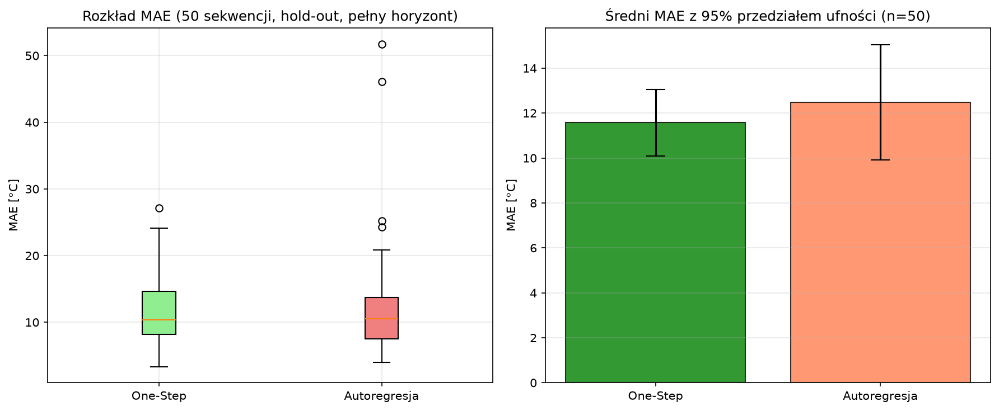

# Transient Thermal Surrogate for SiC MOSFET T_j Estimation

Real-time junction temperature estimation using a **physics-augmented neural surrogate** (U-Net + implicit-Euler residual), designed for deployment on STM32-class microcontrollers.


## Problem

Accurate junction temperature (T_j) estimation in SiC MOSFETs is critical for reliable power electronics design, but traditional FEM/FDM solvers are too slow for real-time control loops. This project replaces the solver with a lightweight neural surrogate targeting <10 ms per frame on an MCU.

## Approach: Hybrid Physics-ML

Instead of a purely data-driven model, we combine an **unconditionally stable physics baseline** with a **learned spatial correction**:

```
ΔT = ΔT_physics + ΔT_correction

ΔT_physics = (α·P − β·h·(T − T_amb)) / (1 + β·h)       ← Implicit Euler (0D)
ΔT_correction = scale · tanh(UNet(P_t, P_{t-1}, T_{t-1}, T_amb, h))  ← Learned
```

**Why this works:**
- The physics residual handles bulk thermodynamics (heating, Newton's cooling) — always stable, even without training
- The U-Net only needs to learn the *spatial correction* (diffusion, hotspot shape, edge effects) — a much easier task
- `tanh` clamping architecturally limits the correction to ±30°C per step — prevents autoregressive blowup

## Results

All numbers below are **out-of-sample** and fully reproducible: the trained
weights ship with the repo (`weights/best_model.pth`, 250 KB), the train/val/
test split is seeded, and the hold-out benchmark generates fresh FDM
sequences from generator seeds outside the training range.

### Hold-out benchmark (the headline)

50 freshly generated FDM sequences (never seen in any form during training),
**full 100-frame autoregressive horizon**, cold start from T_amb, 95% CI:

```bash
python benchmark_eval.py --fresh-data --n 50 --checkpoint weights/best_model.pth
```

| Metric | One-Step | Autoregressive (100 steps) |
|--------|----------|----------------------------|
| MAE | 11.57 °C (CI: 10.09–13.05) | 12.48 °C (CI: 9.91–15.04) |
| RMSE | 20.41 °C | 22.68 °C |

Error accumulation over a 100-step autoregressive rollout is modest:
**+0.9 °C MAE vs one-step** — the physics residual keeps the rollout anchored.



**Physics baseline** (untrained model = implicit Euler only, zero neural
correction; same protocol, `--physics-baseline`):

| Metric | One-Step | Autoregressive (100 steps) |
|--------|----------|----------------------------|
| MAE | 15.58 °C (CI: 13.47–17.69) | 21.30 °C (CI: 17.33–25.27) |
| RMSE | 26.88 °C | 35.08 °C |

The learned correction cuts autoregressive MAE by **~41%** (21.30 → 12.48 °C)
relative to the pure-physics floor.

### Test-split benchmark

50 sequences from the seeded test split (`split_seed=42`, never used in
training), 20-frame windows: one-step MAE 12.10 °C (CI: 8.99–15.22),
autoregressive MAE 12.02 °C (CI: 8.44–15.60) — consistent with the hold-out
numbers.

> **Honest-V&V note:** earlier versions of this README reported MAE
> ≈ 8.6–9.2 °C. Those numbers came from a benchmark whose train/test split
> was re-drawn with an unseeded permutation, so its "test" set overlapped the
> training set. They were retired and replaced by the leak-proof protocol
> above (seeded split + fresh-sequence hold-out).

### Physics sanity checks (4/4 PASS)

Qualitative stability tests — they verify *direction and boundedness* of the
model's dynamics, not accuracy against the solver:

| Test | What it checks | Result |
|------|---------------|--------|
| Step Response | Constant power → monotonic rise | ✓ |
| Cooling Law | P=0, T>T_amb → temperature decays, stays above ambient | ✓ |
| Heat+Cool | Power on/off → correct direction in both phases | ✓ |
| Long Horizon | 300-step sinusoidal → no blow-up (>500°C) or negative T | ✓ |

### Diagnostic Plot


## Architecture

| Component | Details |
|-----------|---------|
| **Parameters** | 48,106 (< 147k STM32 budget) |
| **Inputs** | P_t, P_{t-1}, T_{t-1}, T_amb, h — 5 channels + CoordConv |
| **Output** | ΔT map (32×32) |
| **Encoder** | 3 stages [16, 32, 48 ch] — Depthwise Separable Conv |
| **Bottleneck** | 64 channels |
| **Decoder** | 3 stages [48, 32, 16 ch] — Attention-Gated skip connections |
| **Physics** | Implicit Euler residual (zero extra parameters) |

## Data Generation

The training data comes from a **2D transient FDM solver** coupled with a **SiC loss model** (one-way electrical → thermal coupling):

- **Conduction loss:** P_cond = I²(t) × R_ds_eff
- **Switching loss:** P_sw = f_sw × V_dc × |I(t)| × E_sw
- **Drive cycles:** Random acceleration / braking / idle segments (25% idle for cooling data)
- **FDM solver:** `scipy.integrate.solve_ivp` (BDF method) on 32×32 grid

| Parameter | Range |
|-----------|-------|
| h (convection) | 5,000 – 30,000 W/(m²K) |
| I_peak | 20 – 75 A |
| V_dc | 400 – 800 V |
| T_amb | 25 – 60 °C |
| Grid | 32×32, dt = 0.1s |
| Dataset | 1,000 sequences × 100 frames |

## Known Limitations (read before citing numbers)

Documented in detail in `data_gen.py`; kept as-is because the model was
trained on these conventions — changing them requires regenerating data and
retraining:

1. **Nominal vs effective power.** The Gaussian hotspot is normalized by
   π·σ² while the Gaussian integrates to 2π·σ², so the power injected into
   the domain is ≈1.85× the nominal wattage from the loss model. The dataset
   is internally self-consistent; absolute wattage labels are nominal.
2. **Aliased electrical excitation.** The load sine (f_out = 10–100 Hz) is
   sampled at dt = 0.1 s (Nyquist 5 Hz). Per-frame losses are aliased samples
   of the instantaneous loss, not period averages — the excitation is best
   read as a randomized power profile, not a literal drive cycle. The correct
   fix (period-averaged losses) is on the roadmap.
3. **One-way electro-thermal coupling.** R_ds(on) is constant; the T →
   R_ds(on) feedback is not modeled. Switching-loss scale is deliberately
   conservative vs datasheet values.
4. **Fixed 32×32 grid.** This is a grid-tied surrogate (U-Net), not a
   discretization-invariant neural operator.
5. **Latency target, not measurement.** The <10 ms/frame figure is a design
   target. `export.py` extrapolates desktop ONNX Runtime timings with a
   crude 10–100× factor; the target is unverified until profiled on the
   actual MCU (X-CUBE-AI / CMSIS-NN).

## Training

- **Loss:** Log-Cosh (robust to outliers) + Physics Drill (synthetic cooling enforcement)
- **Regime:** Fully autoregressive from epoch 1 (no teacher forcing)
- **Optimizer:** AdamW, cosine LR schedule (3e-4 → 3e-6)
- **Gradient clipping:** 0.5
- **Hardware:** Apple Silicon (MPS backend), ~13–15 min/epoch; 30 epochs ≈ 6.5 h
- **Shipped checkpoint:** best epoch 28 (val loss 0.0067) → `weights/best_model.pth`


## Quick Start

```bash
# 1. Setup
python3 -m venv venv && source venv/bin/activate
pip install -r requirements.txt

# 2. Reproduce the headline numbers with the SHIPPED weights (no training):
python benchmark_eval.py --fresh-data --n 50 --checkpoint weights/best_model.pth

#    Physics-only floor (no checkpoint at all):
python benchmark_eval.py --fresh-data --physics-baseline --n 50

# --- Full reproduction from scratch ---

# 3. Generate data (~30 min)
python data_gen.py

# 4. Train (~6.5h on Apple Silicon)
python train.py --fresh

# 5. Validate physics (stability sanity checks)
python validate_physics.py --checkpoint weights/best_model.pth

# 6. Diagnostic visualization
python test_vis.py --checkpoint weights/best_model.pth

# 7. Export for STM32
python export.py --checkpoint weights/best_model.pth
```

## Project Structure

```
├── data_gen.py            # FDM solver + SiC loss model (+ documented conventions)
├── model.py               # Physics-augmented U-Net (48k params)
├── train.py               # Autoregressive training + physics drill (seeded split)
├── validate_physics.py    # 4 physics stability sanity checks
├── benchmark_eval.py      # Statistical benchmark (split-based + hold-out --fresh-data)
├── export.py              # ONNX export + INT8 quantization (normalized calibration)
├── test_vis.py            # 9-panel diagnostic visualization
├── requirements.txt
├── LICENSE
├── weights/
│   └── best_model.pth     # Trained weights (epoch 28, 250 KB) — reproduce results without training
└── visualizations/        # Generated plots (all from the shipped checkpoint's run)
    ├── learning_curve.png
    ├── benchmark_holdout.png
    ├── benchmark_50seq.png
    ├── diagnostic_plot.png
    └── physics_validation.png
```

## Key Design Decisions

1. **Implicit Euler, not Explicit** — denominator `(1 + β·h)` > 1 guarantees |gain| < 1 for any `h`, making the physics baseline unconditionally stable.

2. **Zero-initialized correction** — at epoch 0 the model is a pure physics solver. The neural network gradually learns to improve upon it.

3. **No teacher forcing** — training and validation are both fully autoregressive. This eliminates the train/val mismatch that causes oscillating loss curves.

4. **Tanh clamp (±30°C/step)** — architectural hard limit on the correction prevents the neural network from overpowering the physics baseline.

5. **Seeded data split + hold-out benchmark** — the train/val/test split is deterministic (`split_seed`), and `--fresh-data` evaluates on FDM sequences generated from seeds outside the training range, so benchmark numbers cannot silently leak training data.

## License

MIT — see [LICENSE](LICENSE).
